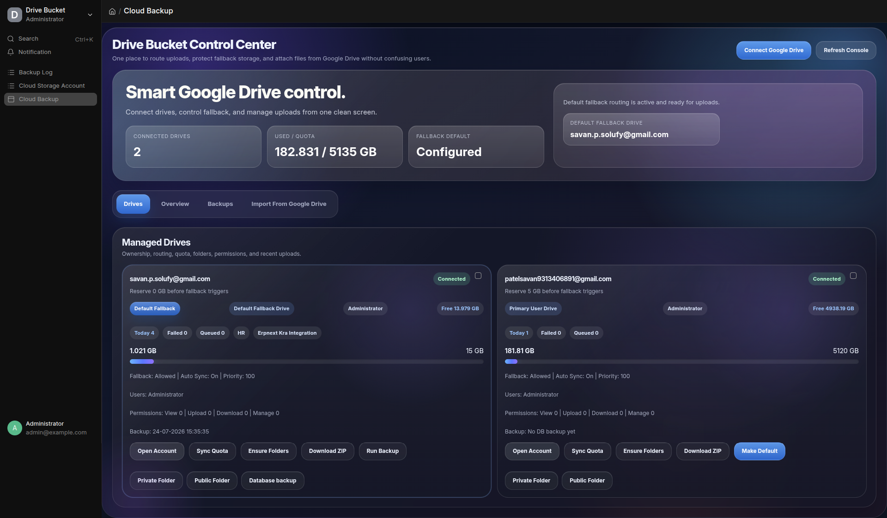
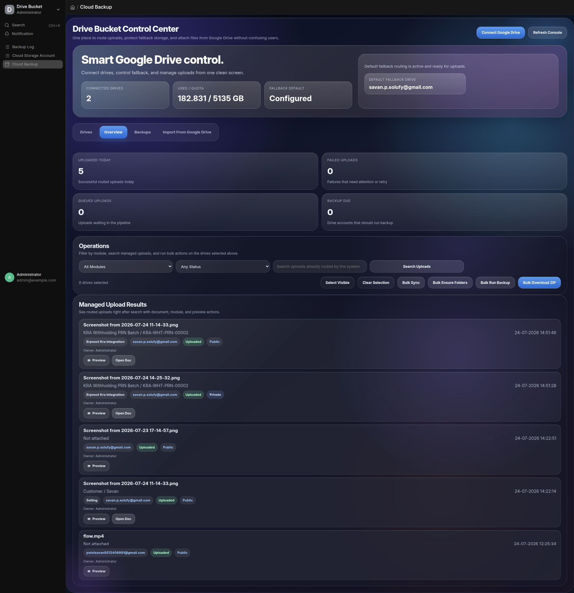
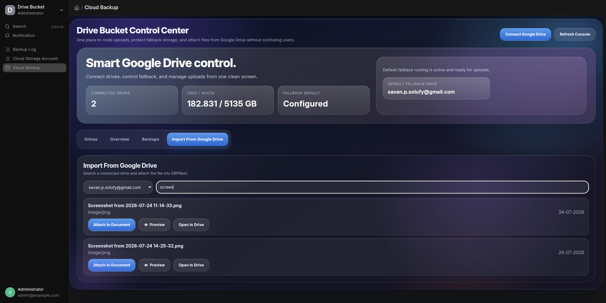
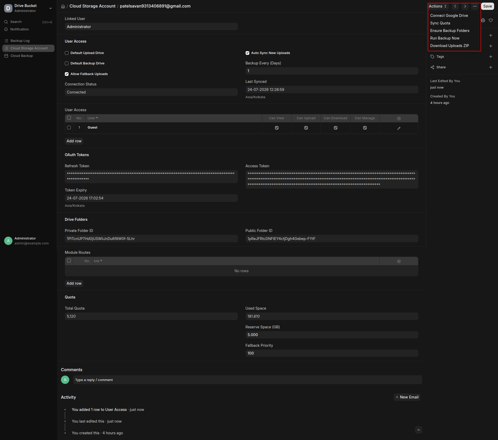

# Drive Bucket

Drive Bucket is a Frappe / ERPNext app for routing ERPNext attachments to Google Drive with multi-account storage, fallback drive logic, module-wise routing, direct Drive import, and database backup support.

It is designed for teams that want to:

- connect multiple Google Drive accounts
- send uploads directly to Google Drive instead of depending only on local file storage
- organize uploads by module and privacy type
- fall back to another drive when a primary drive is unavailable or near full
- import existing Google Drive files into ERPNext attachments
- manage backups, quota, and account actions from one control center

## Features

- Google OAuth2 connection flow using ERPNext `Google Settings`
- one `Cloud Storage Account` record per connected Google account
- direct upload metadata stored on ERPNext `File`
- module-wise routing through `Module Routes`
- fallback drive selection based on availability, reserve space, and priority
- public / private Drive folder separation
- database backup upload to Google Drive
- direct Google Drive import into ERPNext attachments
- Drive Bucket control center page with tabs for:
  - `Drives`
  - `Overview`
  - `Backups`
  - `Import From Google Drive`
- account-level actions like:
  - connect
  - sync quota
  - ensure folders
  - run backup
  - download uploads ZIP

## App Details

- App Name: `drive_bucket`
- Module: `Drive Bucket`
- Publisher: `Savan Patel`
- Email: `savan.p.solufy@gmail.com`
- License: `mit`
- Branch: `develop`

## Requirements

- Frappe / ERPNext bench
- Google Cloud project
- Google OAuth client credentials
- Google Drive API enabled

## Installation

Install the app with Bench:

```bash
cd /path/to/frappe-bench
bench get-app https://github.com/<your-org-or-user>/drive_bucket.git --branch develop
bench --site <your-site> install-app drive_bucket
bench --site <your-site> migrate
```

## Google Cloud Setup

### 1. Create or open a Google Cloud project

Google Cloud Console:

- https://console.cloud.google.com/

### 2. Enable Google Drive API

Enable Google Drive API here:

- https://console.cloud.google.com/apis/library/drive.googleapis.com

### 3. Create an OAuth 2.0 Client ID

Open OAuth client settings here:

- https://console.cloud.google.com/apis/credentials

Create:

- Credential Type: `OAuth client ID`
- Application Type: `Web application`

### 4. Add Authorized Redirect URI

Add this exact redirect URI to your OAuth client:

```text
https://<your-public-domain>/api/method/drive_bucket.cloud_backup.api.google_auth.oauth_callback
```

Example:

```text
https://example.ngrok-free.app/api/method/drive_bucket.cloud_backup.api.google_auth.oauth_callback
```

### 5. Configure OAuth consent screen

Open consent screen settings:

- https://console.cloud.google.com/auth/branding
- https://console.cloud.google.com/auth/audience

Make sure:

- your app branding is configured
- test users are added if the app is still in testing mode
- the connected Google accounts are allowed to use the app

## ERPNext Setup

### 1. Set public site URL

If you are using a public URL or ngrok:

```bash
bench --site <your-site> set-config host_name https://<your-public-domain>
```

### 2. Configure Google Settings

In ERPNext:

- open `Google Settings`
- enable Google integration
- set your `Client ID`
- set your `Client Secret`

Drive Bucket reuses this single shared Google OAuth app for all connected accounts.

## Main Desk Screens

- Control center: `/desk/cloud-backup`
- Cloud Storage Account list: `/app/cloud-storage-account`
- Individual account form: `/desk/cloud-storage-account/<record-name>`

## How The Full Flow Works

This is the recommended order for using the module.

### 1. Manage connected drives from Cloud Backup

Start from the `Drives` tab in the Cloud Backup control center.

This tab is the main place to:

- see all connected drives
- identify the default fallback drive
- review quota usage and free space
- check connected / failed / queued counts
- open Drive folders
- run account actions like quota sync, ensure folders, ZIP download, and backup



### 2. Use Overview for operations and managed upload search

The `Overview` tab shows the operational side of the system.

From here you can:

- view upload and backup summary cards
- filter uploads by module and status
- search routed uploads
- select visible drives
- run bulk actions:
  - bulk sync
  - bulk ensure folders
  - bulk run backup
  - bulk download ZIP
- immediately review search results in the same screen



### 3. Import existing files from Google Drive

The `Import From Google Drive` tab is used when a file already exists in Drive and you want to attach it into ERPNext.

From this screen you can:

- choose a connected Google account
- search Drive files by name
- preview the file
- open it in Google Drive
- attach it directly to a document

This creates a standard ERPNext `File` attachment.



### 4. Configure each Cloud Storage Account

Open the `Cloud Storage Account` form to configure how one drive behaves.

This form is where you manage:

- linked ERPNext user
- default upload drive
- default backup drive
- fallback permission
- auto sync for new uploads
- backup interval in days
- user access table
- module routing table
- quota values
- reserve space and fallback priority

The account form also provides direct actions such as:

- `Connect Google Drive`
- `Sync Quota`
- `Ensure Backup Folders`
- `Run Backup Now`
- `Download Uploads ZIP`



## First-Time Setup Flow

### 1. Open the Cloud Backup control center

Desk route:

```text
/desk/cloud-backup
```

### 2. Connect Google Drive

Use the `Connect Google Drive` button.

This creates a `Cloud Storage Account` automatically after OAuth succeeds.

### 3. Open the account and configure it

Recommended fields to review first:

- `Linked User`
- `Default Upload Drive`
- `Default Backup Drive`
- `Allow Fallback Uploads`
- `Auto Sync New Uploads`
- `Backup Every (Days)`
- `Reserve Space (GB)`
- `Fallback Priority`

### 4. Add module routing

In `Module Routes`, add the modules this drive should handle.

Examples:

- `Sales`
- `Purchase`
- `HR`
- `Manufacturing`
- custom app modules

This keeps uploads organized by business area.

### 5. Ensure folders

Use `Ensure Folders` from:

- the Cloud Backup `Drives` tab
- or the `Cloud Storage Account` form

The app creates and reuses the required Drive folders automatically.

## Folder Structure

Drive Bucket manages storage in a simple structure so users do not need to browse deep or guess where files went.

Recommended structure:

```text
<connected Google Drive>
├── erpnext_backup_private
├── erpnext_backup_public
└── database_backup
    ├── 2026-07-24
    ├── 2026-07-25
    └── ...
```

Inside the public and private areas, the app can group files by configured module routes.

Example:

```text
erpnext_backup_public
├── Sales
├── HR
└── Manufacturing
```

## Routing Logic

When a new ERPNext file is saved:

1. Drive Bucket checks whether the document belongs to a routed module
2. it finds eligible connected drives for that module
3. it checks whether the drive is connected and has enough usable space
4. it applies reserve space and fallback rules
5. it uploads to Google Drive
6. it stores the Google file ID and direct file link on the ERPNext `File`

### What happens if one drive is full

Each account supports:

- `reserve_space_gb`
- `fallback_priority`
- `allow_fallback`

If the remaining space reaches the reserve limit, that drive is treated as unavailable for new uploads.

The app then tries the next eligible fallback drive.

This means:

- one full drive does not stop the whole upload flow
- storage can be scaled across multiple Google accounts
- users still get direct Drive access

## Privacy Handling

The app keeps `Public` and `Private` uploads separated.

This affects:

- which Drive folder receives the file
- who should get access
- how admins manage document visibility

## Cloud Storage Account Fields

Important fields on `Cloud Storage Account` include:

- `account_email`
- `linked_user`
- `is_default_upload`
- `is_default_backup_drive`
- `allow_fallback`
- `auto_sync_uploads`
- `backup_every_days`
- `fallback_priority`
- `reserve_space_gb`
- `connection_status`
- `private_folder_id`
- `public_folder_id`
- `used_space`
- `total_quota`
- `last_synced`

## User Access and Permissions

Each `Cloud Storage Account` includes a `User Access` child table.

Use this to define who can:

- view
- upload
- download
- manage

Typical setup examples:

- HR users can access HR-related drives only
- Sales users can access Sales-related drives only
- Admins can manage shared fallback drives

This keeps access simple and role-based without giving every user access to every Drive.

## File Upload Metadata

New ERPNext `File` records are uploaded automatically after save.

Drive Bucket stores extra metadata on `File`, including:

- uploaded Google account
- Google Drive file ID
- Google Drive file link
- Drive upload status

These values are used for:

- preview
- open document actions
- audit visibility
- retry or support troubleshooting

## Import From Google Drive

The control center supports direct Google Drive import.

From `/desk/cloud-backup`:

1. open `Import From Google Drive`
2. choose a connected account
3. search Drive files
4. click `Attach to Document`
5. choose:
   - target DocType
   - target document name
   - optional target field
   - private or public attachment behavior if applicable

## Backup Behavior

Drive Bucket supports database backup uploads to Google Drive.

### Account-level backup settings

Use these fields on `Cloud Storage Account`:

- `Default Backup Drive`
- `Backup Every (Days)`

If no backup interval is set, the system treats it as daily.

### Manual backup

You can manually run backup from:

- the `Cloud Storage Account` form with `Run Backup Now`
- the Cloud Backup `Drives` tab with `Run Backup`
- the Cloud Backup `Overview` tab using bulk backup actions

### Backup storage location

Database backups are uploaded to the Drive backup folder and can be grouped by date.

## ZIP Download

Each connected account supports a ZIP download action for its routed uploads.

You can download:

- one account at a time from `Drives`
- multiple selected accounts from `Overview`

This is useful when users want one-click export instead of opening each file individually.

## Recommended Admin Policy

For a client-ready setup:

- connect one primary drive per active ERPNext user or business owner
- configure exactly one default fallback drive
- configure one default backup drive
- keep reserve space above zero
- keep module routes explicit instead of leaving them ambiguous
- review `User Access` permissions before going live
- use backup intervals that match the business risk of the site

## Testing Checklist

After setup, test the following:

### OAuth

- `Connect Google Drive` opens Google consent screen
- callback returns to ERPNext successfully

### Folder creation

- private folder exists
- public folder exists
- backup folder exists

### Quota sync

- `used_space` is visible
- `total_quota` is visible
- `last_synced` updates

### Upload routing

- upload a file as a user with a routed module
- confirm it lands in the correct Drive
- confirm the ERPNext `File` shows the Google link
- confirm fallback works when the primary drive is near full

### Import flow

- search a Drive file
- preview it
- attach it to a document
- verify the attachment appears on the target document

### Backup flow

- run `Run Backup Now`
- confirm the backup file appears in Google Drive
- confirm the backup log updates

## Troubleshooting

### `redirect_uri_mismatch`

Your Google OAuth client redirect URI does not exactly match the ERPNext callback URL.

Check:

- `host_name` in site config
- Authorized Redirect URI in Google Cloud

### `Google Drive API has not been used in project`

Enable Google Drive API:

- https://console.cloud.google.com/apis/library/drive.googleapis.com

### Connected account appears but folders or quota are missing

Run:

- `Sync Quota`
- `Ensure Folders`

and confirm the connected Google account still has valid consent.

### Upload goes to fallback unexpectedly

Check:

- `reserve_space_gb`
- `allow_fallback`
- `fallback_priority`
- module routes
- connection status

### Backup folder or backup file is missing

Check:

- the account is marked as `Default Backup Drive`
- `Ensure Backup Folders` or `Ensure Folders` has been run
- the backup interval is configured correctly
- the OAuth token is still valid

## Bench Commands

Useful commands:

```bash
bench --site <your-site> migrate
bench --site <your-site> clear-cache
bench --site <your-site> list-apps
bench --site <your-site> execute drive_bucket.cloud_backup.api.control_center.get_console_data
```

## Development Notes

This app currently includes:

- Google OAuth connection flow
- quota sync
- automatic upload routing
- module-wise Drive routing
- fallback drive logic
- direct Google Drive import
- account-level ZIP download
- database backup upload
- Cloud Backup control center

## License

mit
